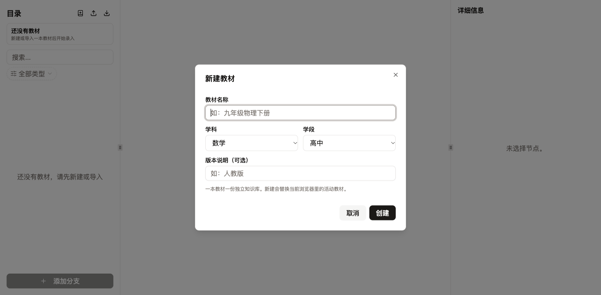
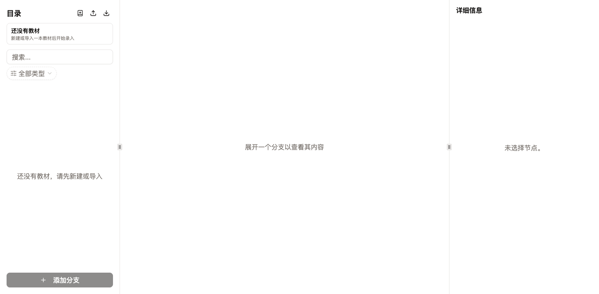
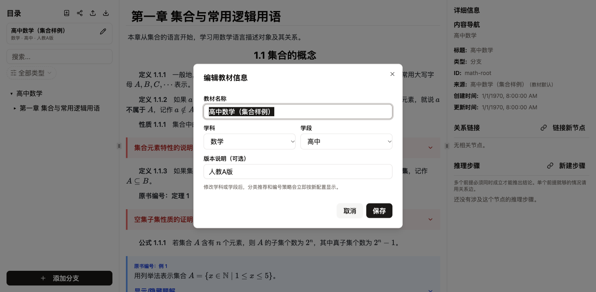
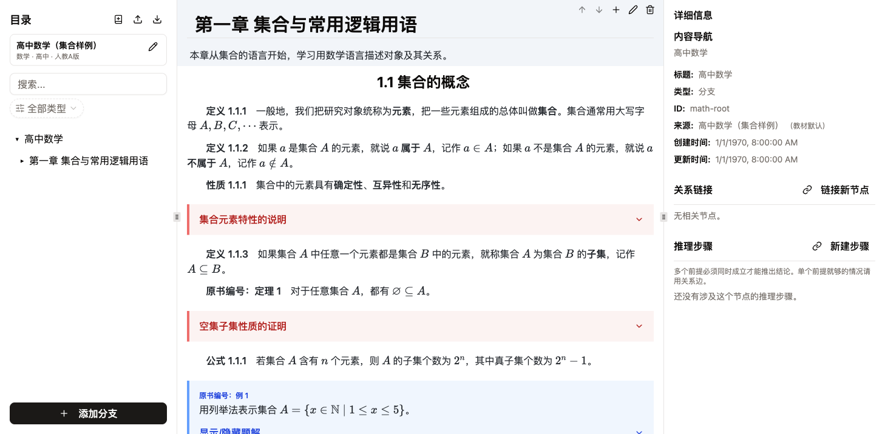
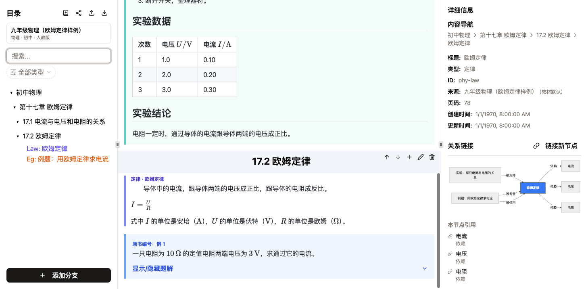
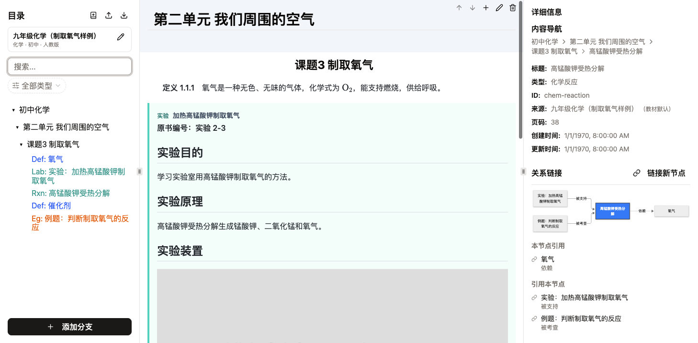
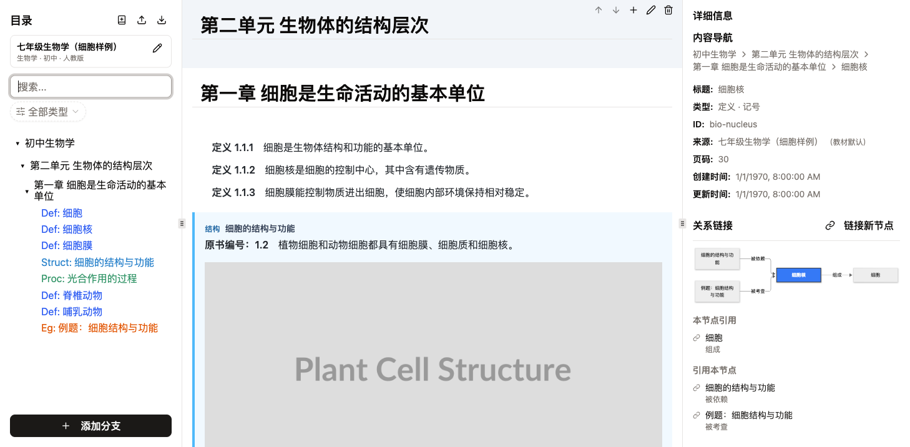
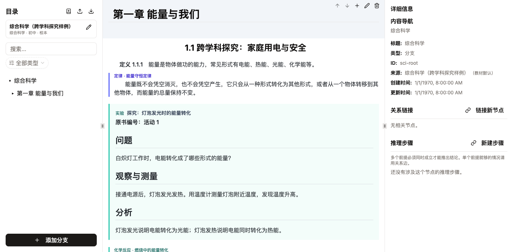

# v8 验收记录

- 日期：2026-10-26
- 环境：本地 `bun run dev` / `vite preview`（Vite 8），ego-lite Chromium，1400×720 视口
- 数据：`examples/v8-*.json`
- 结论：`bun run test` 102 项通过，`bun run lint`、`bun run build` 通过；下列人工核对项全部通过。2026-10-26 依赖升级后已复跑测试，并用开发/生产构建分别验证 mhchem、Mermaid 和可拖拽面板。

## 复现方式

```bash
bun install
bun dev
```

打开 <http://localhost:5173>，用左侧栏的「导入」依次导入每份样例，确认覆盖当前库即可。

## 人工核对

| 检查项 | 结果 | 证据 |
|---|---|---|
| 新建教材可选学科/学段/名称/版本，创建后显示教材身份 | 通过 | 下图「新建教材」 |
| 导入 v8 后自动启用 `book.subject` 对应的分类与筛选 | 通过 | 物理/化学/生物截图 |
| 数学定义、定理、题目的自动编号与原有视觉不回退 | 通过 | 下图「数学」 |
| 原书编号优先显示并标注「原书编号」 | 通过 | 物理实验「实验 1」、例题「例 1」 |
| 非数学学科不伪造定律/实验编号 | 通过 | 物理定律只显示「定律 · 欧姆定律」，不显示「定律 1.1.1」 |
| 实验卡片含标题、原书编号、Markdown 小节、数据表、图片 | 通过 | 下图「物理」 |
| `supports`：实验 → 定律；关系图显示「被支持」 | 通过 | 下图「物理」右侧关系区 |
| `part-of`：细胞核 → 细胞；关系图显示「组成」 | 通过 | 下图「生物学」 |
| `is-a` 样例可导入，端点只允许两个定义 | 通过 | `v8-biology.json`、`science-relations.test.ts` |
| `mhchem`：`\ce{...}` 与反应条件在阅读视图渲染，无 KaTeX 错误 | 通过 | 下图「化学」 |
| 编辑预览与阅读视图使用同一套 KaTeX 配置 | 通过 | 编辑反应节点时 textarea 保留 `\ce{`，预览 1 个 KaTeX、0 个错误 |
| 编辑节点可保存页码与原书编号，保存后立即按原书编号显示 | 通过 | 手动将「子集」原书编号改为「定义 9」并保存 |
| v7 备份导入被明确拒绝，当前 v8 库不变 | 通过 | 提示「这是 v7 备份……旧数据不会自动迁移」，书名/节点仍为当前库 |
| 新建教材替换当前库前有二次确认 | 通过 | 空库直接创建；非空库弹出「替换当前教材？」 |
| 点教材卡片铅笔可编辑名称/学科/学段/版本，保存后立即生效 | 通过 | 标题与「物理 · 初中 · 修订版」即时更新 |
| 已有 `supports` 关系时，把实验 kind 改成「讲解」被拒绝 | 通过 | 提示「改成「讲解」会让已有关系「实验……支持 欧姆定律」不再合法」，编辑器保持打开 |
| 未创建教材时「添加分支」禁用，store 也拒绝创建节点 | 通过 | 按钮禁用并提示「请先新建或导入教材」；单元测试覆盖 store 拒绝 |
| 综合科学库可同时使用多学科 kind 与关系 | 通过 | `v8-science.json` 导入零警告 |

## 复审修复记录

2026-10-26 二次复审后补了三处：

1. 修改节点 `kind` 时检查所有相连关系是否仍满足 `isEdgeAllowed()`，不合法直接阻止保存。
2. `createNode()` 在没有 `book` 时拒绝写入；未建教材时「添加分支」禁用，目录树显示引导文案。
3. 教材卡片增加编辑入口，可修改名称、学科、学段和版本；修改只更新 `book`（默认根分支仍叫旧书名时一起改名），不重建整库。

新增回归测试：`src/lib/science-relations.test.ts` 的 kind 变更用例、`src/stores/useGraphStore.test.ts`。

## 截图

### 新建教材



### 未创建教材时禁止添加分支



### 编辑教材信息



### 数学：集合、定义、命题、证明、例题



### 物理：实验数据表、欧姆定律、`supports`



### 化学：实验安全、`mhchem` 化学方程式



### 生物学：`part-of`、`is-a`



### 综合科学：一本库里的跨学科内容



## 样例说明

- 样例是用于验收结构的精简文本，按常见教材内容组织，不宣称逐字复制某一版教材。
- 图片使用 `placehold.co` 占位图，只验证 Markdown 图片位置与加载；正式录入时替换为稳定图床 URL 并补 alt 文本。
- 五份样例都通过 `parseGraph` 全图校验，导入时零警告；`bun run check:examples` 可复跑。
